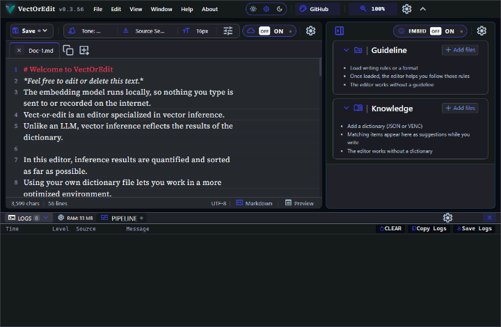

# VectOrEdit (`vect-or-edit`)
**Next-Generation Vector-based Semantic Knowledge Editor & Real-Time Linter**

[](https://github.com/1abcdefggs/vect-or-edit/releases)
[](https://github.com/1abcdefggs)
[](LICENSE)
[](https://github.com/1abcdefggs/vect-or-edit)
[](https://github.com/1abcdefggs/vect-or-edit)
[](https://www.electronjs.org/)
[](https://microsoft.github.io/monaco-editor/)
[](https://vitejs.dev/)
[](https://www.typescriptlang.org/)
[](https://napi.rs/)
[](https://onnxruntime.ai/)
[](https://huggingface.co/docs/transformers.js)
[](https://github.com/googleapis/genai-js)
[](https://vitest.dev/)
[](https://nodejs.org/)
[](https://github.com/1abcdefggs/vect-or-edit/pulls)
<p align="center">
  
</p>

<p align="center">
  Past versions: <a href="docs/assets/repository-ui-v0312.gif">v0.3.14</a> · <a href="docs/assets/repository-ui-v031.gif">v0.3.1</a> · <a href="docs/assets/repository-ui-v020.gif">v0.2.0</a>
</p>

**VectOrEdit** is a standalone, high-performance desktop editor designed for knowledge management, structured document drafting, and real-time semantic validation. It seamlessly integrates a native Rust-powered vector indexing engine (HNSW) with local transformer embeddings, multi-provider AI connectors, and Monaco Editor.

> ※ Vector search needs a dictionary file (`kb_*.json` or `.venc`) generated beforehand, for example with `vect-or-generate`. The editor does not create dictionaries. Without one loaded, it works as a plain text editor and vector search does not run.

---

## User Guide & Core Workflows

### 1. Vector Search & Semantic Suggestions

- **Selection Auto-Popover**: Select any word or phrase in the editor; a popover automatically appears below the cursor showing cosine-similarity matches from the active knowledge base (`kb_*.json` / `.venc`).
- **Keyboard Trigger**: Press <kbd>Alt</kbd>+<kbd>S</kbd> on the current word or selection to query the vector engine.
- **Insert Candidate**: Click any suggested term in the popover or sidebar to replace the selection with standard canonical terminology.

### 2. Knowledge Slots & Guideline Management (Right Sidebar)

- **Open / Collapse Sidebar**: Press <kbd>Ctrl</kbd>+<kbd>B</kbd> or click the sidebar toggle button on the top-left of the sidebar.
- **Embedding Toggle & Quick Settings**: Turn on **EMBED** in the header or the sidebar to enable dictionary search. EMBED is independent of the LLM button, so either can be on or off on its own. The gear icon (**`⚙️`**) opens the Vector and Knowledge settings.
- **Add Knowledge Slot**: Click **Add files** in the Knowledge section to dynamically load and merge domain JSON datasets.
- **Load Presets / Guidelines**: Click **Add files** in the Guidelines section to load drafting rules and linting schemas (`guideline_*.json`).
- **Filter Thresholds**: Adjust the **Threshold** (%) score input and the **Max results** selector in the sidebar to control suggestion precision and candidate volume.

### 3. Settings & UI Customization

- **Open Settings**: Press <kbd>Ctrl</kbd>+<kbd>,</kbd> or click the gear icon (`⚙️`) in the header or area toolbars.
- **Granular UI Visibility**: In the Settings modal, click the eye icon (**`👁️` / `🚫`**) next to any UI item to instantly show or hide that button/menu on the main interface.
- **Reset Layout**: If essential controls are hidden, right-click the bottom status bar or editor margin and select **`Reset Layout (UI Display)`** to restore all defaults.

### 4. File Operations & Multi-Tab Drafting

- **New / Open / Save**: Use standard shortcuts (<kbd>Ctrl</kbd>+<kbd>N</kbd>, <kbd>Ctrl</kbd>+<kbd>O</kbd>, <kbd>Ctrl</kbd>+<kbd>S</kbd>) or the top menu bar.
- **AutoSave**: Open the arrow beside **SAVE**, choose **AutoSave**, and the LED on the SAVE button shows whether it is on or off.
- **Duplicate Tab**: Click the duplicate icon (`+`) on the tab bar to branch your current document into a new tab.
- **Rename Tab**: Double-click any tab title to rename it with an instant high-contrast overlay input.

---

## What's New

### v0.3.56 (2026-11-02)

- Tooltip and first-run icon sizes come from the shared type scale.

### v0.3.55 (2026-10-27)

- Each knowledge slot has an Info button that shows its dictionary header. An encrypted slot shows the header only while its password is loaded.
- A loaded dictionary shows its domain as the slot title.

### v0.3.54 (2026-10-27)

- Closing the window with the × button asks first, the same as File > Exit.
- Empty search results say why: the search model is off or not ready, or nothing matched.

### v0.3.53 (2026-10-26)

- The minimum score and the auto-save delay fields have − and + buttons.

See the full release history in [CHANGELOG.md](CHANGELOG.md).

## Core Features & Capabilities

- **Registry-Driven Settings & UI Visibility Binding**: Fully synchronized preferences and layout visibility via `data-ui="{area}:{element}"` architecture, allowing granular element show/hide toggles with instant CSS-level reflection and zero-overhead state persistence (`.settings.json`).

- **Native Rust HNSW Engine**: Blazing-fast vector similarity search and semantic linting powered by native Rust N-API bindings (`@1abcdefggs/vect-or-engine`).
- **100% Offline & Private (Local Mode)**: Zero external telemetry required. Vector embeddings (`multilingual-e5-small`) run entirely locally on CPU with WebAssembly SIMD & ONNX Runtime.
- **Hybrid AI Provider Integration**: Switch between Local Offline Embeddings and cloud LLMs. Google Gemini (`@google/genai`) is verified with `gemini-3.1-flash-lite` and Flash models; the OpenAI and Anthropic Claude connectors are included but not yet verified.
- **Monaco IntelliSense & Semantic Linter**: Multi-dimensional auto-completion matching Kanji, Hiragana, Katakana, and international terminology with instant documentation hover previews.
- **Command-Driven Navigation & Header Extras**: Centralized `CommandManager` architecture with streamlined header controls (theme selector, zoom, language switcher, window actions).
- **Streamlined Selection Popover & Widget**: Select any text to immediately trigger semantic vector matching or external queries with intelligent context-menu exclusion.
- **Dynamic Multi-Slot Knowledge & Presets**: Load, merge, and inspect multiple domain JSON slots (`kb_*.json`) or drafting templates dynamically.
- **Curated Modern Themes with Light & Dark Modes & Windows TitleBar Overlay**: Bundled with `Cyberpink`, `Dracula`, `GitHub`, `Monochrome`, `Monokai`, `Night Owl`, `Solarized`, `Tomorrow` and `Tukune`, each with a light and a dark face; the appearance mode (System / Light / Dark) picks the face, syncing with Windows native control buttons. A theme is `Name.json`, or `Name.light.json` + `Name.dark.json`.
- **Dynamic Bilingual UI (i18n)**: Seamless English & Japanese live switching without restart.
- **Real-Time Diagnostic Pipeline**: 7-stage LED status indicators monitoring Rust DLL, Knowledge Base, Config, Theme, Locale, Monaco, and AI Engine.


---

## Getting Started

### Prerequisites

- [Node.js](https://nodejs.org/) (v22.12 or higher)
- [Rust](https://www.rust-lang.org/) & `cargo` (for compiling native N-API engine bindings)
- `npm` or `pnpm`

### Installation & Run

```bash
# Clone the repository
git clone https://github.com/1abcdefggs/vect-or-edit.git
cd vect-or-edit

# Install dependencies
npm install

# Run in development mode
npm run dev
```

### Testing & Quality Assurance

```bash
# Run automated test suites (Vitest)
npm run test

# Type checking across main, preload, and renderer
npm run typecheck
```

### Building for Production & Windows `.exe`

```bash
# Compile and build standalone bundle
npm run build

# Package Windows Standalone Installer (.exe) & Portable Executable
npm run build:win
```

> **Updates**: The installer build is the primary distribution and updates itself. The portable build does **not** update itself. When a new version is available it shows a notice that links to the release page, and you download the new portable build from there.

---

## Security Architecture & Dual-Lock Spec

`vect-or-edit` follows the official **Electron Security Guidelines**:
- **Context Isolation & Sandbox**: Renderer runs with complete process isolation.
- **Typed IPC Bridge**: Direct `ipcRenderer.invoke` is strictly prohibited. Only explicit, typed methods (`engineAPI.querySemantics`) are exposed via `contextBridge`.
- **Knowledge Vault & Decryption**: Encrypted `.venc` knowledge slots are decrypted in the main process with a password. The security design is described in the workspace spec `SECURITY_AND_ENCRYPTION_ARCHITECTURE_SPEC.md`.


---

## UI Architecture & Element Binding Standard

`vect-or-edit` employs a declarative, zero-UI-framework binding architecture to manage top-page controls and settings modal synchronization:

- **Strict Area Scoping (`data-ui`)**: Every customizable UI component is tagged with a standardized 4-quadrant area scope:
  - `hdr:` — **Header & TitleBar Area** (Logo, menus, theme/locale selectors, settings button)
  - `edt:` — **Editor & Toolbar Area** (Monaco typography, diff mode, inline AI toggles)
  - `sbr:` — **Knowledge Sidebar Area** (Vector search input, similarity thresholds, metadata views)
  - `sys:` — **System & Bottom Bar Area** (Status metadata, 7-stage LED pipeline, log console)
- **Zero-DOM-Destruction Toggling**: Elements are toggled using native `[hidden]` CSS enforcement (`display: none !important;`), preserving editor focus, undo history, and event listeners without re-rendering.
- **Dual-Sync Persistence**: Fast memory caching (`localStorage`) coupled with asynchronous IPC `.settings.json` disk persistence for seamless VS Code-compatible settings management.
- **Fail-Safe Rescue**: Permanent fallback access via global keybinding (<kbd>Ctrl</kbd>+<kbd>,</kbd>) and status bar context menus (`Reset Layout (UI Display)`).

---

## Project Architecture

```text
vect-or-edit/
├── electron.vite.config.ts      # Electron-Vite bundling configuration
├── vitest.config.ts             # Vitest test runner configuration
├── package.json                 # Project dependencies & scripts
├── scripts/                     # Build & maintenance scripts
├── public/                      # Static assets (icon.png, icon.ico, IME dicts)
├── docs/                        # Architecture & settings specifications
├── tests/                       # Automated test suites
└── src/
    ├── main/                    # Electron Main process (IPC handlers, Window management)
    ├── preload/                 # Secure Context-Isolated IPC bridge
    └── renderer/                # Front-end UI (TypeScript/CSS, Monaco, Web Workers)
        ├── renderer.ts          # Front-end main entry point
        ├── index.html           # Main HTML shell
        ├── style.css            # Root stylesheet imports
        ├── core/                # State managers (settingsStore, statusManager, i18n, icons)
        ├── components/          # Specialized UI templates & HTML modules
        ├── editor/              # Monaco editor core, tabs, themes, context menus
        ├── search/              # Vector search, local AI worker, dictionary pipeline
        ├── ui/                  # UI components, modals, topbar, settings facade
        ├── css/                 # Stylesheets (header.css, header-extras.css, etc.)
        ├── assets/              # App branding & static assets
        ├── locales/             # i18n dictionaries (en.json, ja.json)
        ├── themes/              # Monaco theme JSON definitions
        └── types/               # TypeScript type definitions (settings.ts, global.d.ts)

```

---

## Author & Maintainer

- **Author**: [@1abcdefggs](https://github.com/1abcdefggs)
- **Repository**: [https://github.com/1abcdefggs/vect-or-edit](https://github.com/1abcdefggs/vect-or-edit)
- **Issue Tracker**: [https://github.com/1abcdefggs/vect-or-edit/issues](https://github.com/1abcdefggs/vect-or-edit/issues)

---

## License

This project is licensed under the [MIT License](LICENSE) © 2026 1abcdefggs.
